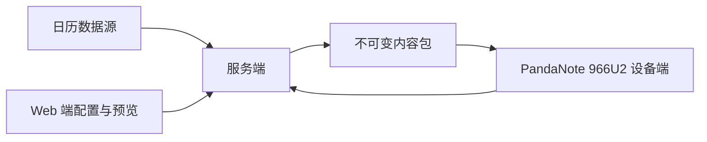

# PandaNote 966U2

电子墨水日程终端与内容管理系统。项目包含设备端、Web 端和服务端：服务端读取日历并生成可校验的内容包，Web 端完成配置与预览，设备端负责同步、展示与低功耗交互。

> **阶段：开发预览版。** 三端源码均在公开范围。完整设备构建仍需单独准备目标工具链、Qt 头文件和运行库；公开源码不包含原厂固件、生产配置或真实用户数据。

## 从这里进入

| 端 | 代码与文档入口 | 主要职责 | 开发 | 部署 |
| --- | --- | --- | --- | --- |
| 设备端 | [apps/reader-shell](apps/reader-shell/README.md) | 原生界面、电子墨水刷新、同步、按键、休眠、无线辅助进程 | [开发与测试](apps/reader-shell/docs/DEVELOPMENT.md) | [构建与部署边界](apps/reader-shell/docs/DEPLOYMENT.md) |
| Web 端 | [apps/manager/frontend](apps/manager/frontend/README.md) | 日历配置、背景裁剪、内容预览与设备工作区 | [开发与测试](apps/manager/frontend/docs/DEVELOPMENT.md) | [静态资源部署](apps/manager/frontend/docs/DEPLOYMENT.md) |
| 服务端 | [apps/manager](apps/manager/README.md) | 日历接入、存储、同步协调、认证与设备 HTTP 接口 | [开发与测试](apps/manager/docs/DEVELOPMENT.md) | [本地与云角色部署](apps/manager/docs/DEPLOYMENT.md) |
| 共享协议 | [apps/shared](apps/shared/README.md) | 内容包、桥接契约、设备通信与合成夹具 | 与生产者、消费者同步修改 | 不单独部署 |

各端 README 是该端的入口。根目录只保留项目总览与共同规范；具体启动命令、依赖、构建条件和部署限制在各端文档维护。

## 系统关系



内容包由 `content.ini`、`background.png` 和 `SHA256SUMS` 组成。设备获取、校验、显示与确认是不同状态；服务端发布成功不等同于设备已经刷新。

## 仓库结构

```text
.
├── README.md                       # 总览与各端入口
├── apps/
│   ├── reader-shell/               # 设备端独立源码、测试与部署辅助组件
│   │   ├── README.md
│   │   ├── docs/                   # 开发与部署说明
│   │   ├── tests/
│   │   ├── radio/
│   │   └── deploy/
│   ├── manager/                    # 服务端与 Web 构建的集成边界
│   │   ├── README.md
│   │   ├── docs/                   # 服务端开发与部署
│   │   ├── manager/                # Python 服务端源码
│   │   ├── tests/
│   │   └── frontend/               # Web 端独立源码与文档
│   │       ├── README.md
│   │       ├── docs/
│   │       └── src/
│   └── shared/                     # 三端共享协议与合成数据
├── docs/                           # 跨端架构、发行与第三方清单
├── .github/                        # CI、秘密扫描与协作模板
├── CONTRIBUTING.md
├── SECURITY.md
├── GOVERNANCE.md
├── THIRD_PARTY.md
├── THIRD_PARTY_NOTICES.txt
├── CHANGELOG.md
└── LICENSE
```

Web 代码单独位于 `frontend/`，构建产物由服务端提供；两者保留集成目录关系，便于执行现有锁文件、构建和打包流程。

## 质量与验证

本次公开整理中，服务端 221 项测试通过，Web 端 28 项测试、类型检查和生产构建通过。设备端主机策略测试结果见 [发行记录](docs/RELEASE.md)。设备完整交叉编译、真机安装与生产账号未因本次整理重新验收。

仓库配置 CI 和 Secret scan。请以 GitHub Actions 当前运行结果为准；工作流存在不代表已通过。共同发布要求包括：来源与许可清楚、源码与构建产物一致、凭证与个人数据不入库、验证范围明确。

## 参与与安全

[贡献规范](CONTRIBUTING.md) · [安全政策](SECURITY.md) · [维护规则](GOVERNANCE.md) · [架构](docs/ARCHITECTURE.md) · [第三方说明](THIRD_PARTY.md) · [发行记录](docs/RELEASE.md) · [仓库复核记录](docs/REPOSITORY_AUDIT.md)

生产密钥、设备凭证、日历账号、个人事件、原厂镜像及原始运行日志不得提交。TLS 测试使用运行时生成的临时密钥；仓库不分发私钥。

## 许可证

自有代码采用 [MIT](LICENSE)。第三方字体、启动适配、组件和库保留各自许可，详见相应目录和 [第三方说明](THIRD_PARTY.md)。
