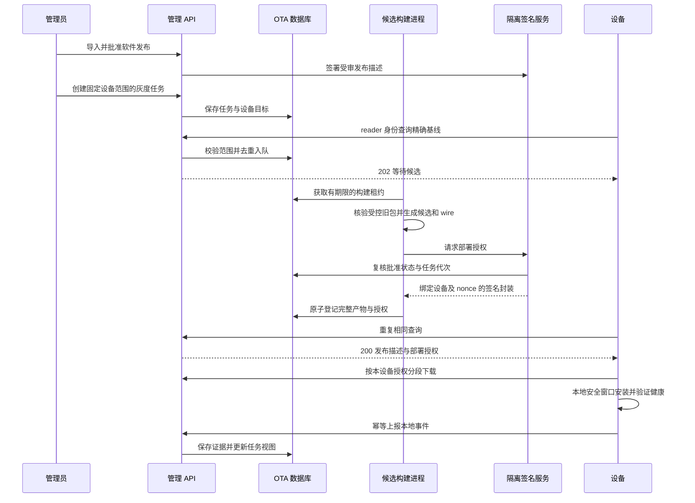

# 管理端 OTA 升级详细设计

本设计供管理端、发布流水线及设备端实施者使用，覆盖软件版本入库、发布审批、逐设备候选生成、灰度任务、设备下载与结果追踪。管理端批准“哪台设备可以安装哪个发布”，设备端依据签名、本机基线和本地安全窗口决定能否安装。设备端事务与恢复约束以 [设备端 OTA 自动升级详细设计](../../reader-shell/docs/OTA-DESIGN.md) 为配套基线。

本次交付为详细设计。下述 OTA 模块、数据库、接口、页面和测试均为拟新增能力；当前服务只实现内容发布与显示确认。首版面向已完成 OTA 引导部署的 966U2，不承担内核、bootloader、分区、用户数据迁移或自动跨启动回滚；首次启用仍须受控安装设备端 worker、可信公钥及 OTA helper。

## 现有代码与复杂度

代码基线为 `9c7195326c91815184fd4c0c639db1c15798418d`。以下路径相对仓库根目录。

| 现有文件 | 已有事实 | 管理端设计约束 |
| --- | --- | --- |
| `apps/manager/manager/app.py`、`cloud_auth.py` | 本机管理会话；云管理 Cookie、同源校验及 CSRF；云设备 Bearer 映射稳定 ID | 管理操作沿用管理身份；设备 token 无权创建任务或审批发布 |
| `apps/manager/manager/reader.py`、`reader_listener.py` | 独立 reader app、严格 Host、Bearer、正文长度及文件读取边界；本地只有单个 token | 复用设备入口，不把管理 API 暴露到 reader；本地 OTA 另需显式 token 到设备 ID 的绑定 |
| `apps/manager/manager/cloud.py`、`fleet.py` | 云 reader 与 admin 分角色；`DeviceScopes.root_for` 处理设备根和历史单设备根 | OTA 身份使用认证 ID；保持既有内容根映射，不能凭 URL 或请求正文选择设备 |
| `apps/manager/manager/store.py` | 内容 `state.sqlite3`，不可变 `versions/<32hex>`，`reader_status` 记录联系及显示 ACK | 软件发布使用独立目录和数据库；不修改内容版本、日历配置或显示时间 |
| `apps/manager/frontend/src/Workspace.tsx`、`DeviceWorkspace.tsx` | `#releases`、`#ota`、软件版本及升级记录为占位 | 接入真实状态与空态，软件升级和内容发布分别展示 |
| `apps/reader-shell/deploy/normal_boot/upgrade_profile.py` | `capture_old` 核验完整旧包；`bind` 绑定旧闭包与根超级块摘要 | 每个候选必须有受控旧包，不能向所有设备直接分发同一事务包 |
| `apps/reader-shell/deploy/normal_boot/build.py`、`normal_upgrade.py` | `build` 接受完整旧包与超级块；`capture_bundle` 生成有界 wire | 构建在隔离进程中执行；HTTP 进程不执行 ADB、设备写入或回退命令 |

设计工作复杂度中等，可以沿既有架构连续完成。后续完整实现复杂度中高，主要成本是签名隔离、完整基线留存、发布与撤回的并发控制及设备报告关联，不需要替换 Web 框架或内容同步架构。按一名熟悉代码的工程师估算，管理端实现和主机验证约 12 至 18 个工作日；设备端实现、真机和签名基础设施准备另计。

当前仓库没有可供核实的运行数据库，本设计不推断生产设备身份、不迁移真实数据。实施迁移或启用时，若模块文档、数据库身份及代码映射不一致，应停止写入并报告。

## 组件与信任边界

新增独立 `OtaService` 和 `OtaStore`，由 admin、reader 与候选 worker 使用同一显式 OTA 根配置。首版在同一主机使用独立进程及本地 SQLite，不引入消息中间件。SQLite 负责持久任务与租约，签名服务持有独立身份和私钥，普通 API 及构建进程都不能读取私钥。



管理 API 只能导入到私有暂存区并改变发布策略；受审输入通过摘要进入构建目录。构建进程使用固定仓库快照、固定工具入口及参数数组，不执行上传的脚本，不接受客户端路径、命令或远程 URL。签名服务根据独立维护的发布批准记录核验签名请求，不提供“任意摘要签名”接口。

云端沿用 `CloudProfile.device(request)` 和可信反向代理边界。OTA 路由额外拒绝 Cookie 头，即使同时有 Bearer；拒绝 Origin、查询串、重定向及重复身份头。现有 reader 的内容路由保持原行为。云管理操作继承 Cookie、同源和 CSRF，禁止 Bearer 代替管理员会话；本机管理沿用本机来源及会话边界。

本地 reader 的旧单 token 不自动获得 OTA 权限。新增私有 OTA 配置显式绑定 `device_id`、凭证摘要、型号、引导版本及 helper 摘要，由受控接入核验该 token 仅属于一台设备。无法证明唯一性的共享 token 仅继续内容同步；OTA 返回 `ota_not_enrolled`。首版签名根固定，根轮换走受控引导部署。

## 数据与不可变产物

OTA 目录拟为 `<data-root>/ota/`，与内容 `versions/` 分开；设备记录用稳定 ID 关联 `DeviceScopes`，不将设备 ID 拼入任意用户路径。目录 0700，数据库、输入和签名文件 0600，所有路径逐层拒绝符号链接；文件要求普通文件且单硬链接。拟定布局如下。

```text
ota/
  state.sqlite3
  objects/<sha256>
  staging/<32hex>/
```

对象摘要覆盖原始字节；对象类型、长度、引用与来源存入数据库。`release_sha256` 定义为已签名发布描述的原始 payload 字节摘要，不是封装摘要；`candidate_sha256` 为完整候选 `manifest.json` 原始字节摘要，`bundle_sha256` 为 wire 摘要。原始封装单独保留，验签前不得重新序列化。`native_sha256` 沿现有包契约标识 native manifest 与 release 目录，不能误当作 `reader-shell.mipsel` 的 ELF 摘要；ELF 摘要从文件闭包取出。`boot_id` 是包中的 24hex system 标识，不用作报告的时间顺序。

| 拟新增表 | 关键字段与约束 | 职责 |
| --- | --- | --- |
| `ota_schema` | 单行版本号 | 独立迁移版本，首版为 1 |
| `ota_objects` | `sha256` 主键，类型、长度、核验时间 | 不可变对象索引；文件先持久化，再提交引用 |
| `ota_devices` | `device_id` 主键，型号、引导能力、helper 摘要、允许渠道、已确认基线、最近报告时间 | 配置与观测分列；本地自动安装开关未上报则显示未知 |
| `ota_baselines` | `package_sha256` 主键，完整 manifest、文件对象引用、来源、审核状态 | `capture_old` 所需完整旧包，不能只有 SHA 或清单 |
| `ota_releases` | `release_id` 32hex 主键，型号、渠道、`sequence`、payload 摘要、签名封装、输入快照、状态、`revision` | 唯一约束 `(model,channel,sequence)`；批准后内容不可变 |
| `ota_sequences` | `(model,channel)` 主键，下一个序号 | `BEGIN IMMEDIATE` 中分配正整数；上限 `2^53-1`，废弃序号不回收 |
| `ota_campaigns` | `campaign_id`、release、状态、当前批次、策略、`revision` | 固定发布与设备快照；不因设备列表变化自动扩容 |
| `ota_targets` | `(campaign_id,device_id)` 主键，批次、分配状态、lease、终态 | 同一设备最多一个未终结目标，使用部分唯一索引限制 |
| `ota_jobs` | `job_id`、构建键、状态、租约代次、重试数、固定输入摘要 | 构建键唯一，跨进程去重及崩溃接管 |
| `ota_artifacts` | 构建键、候选摘要、bundle 摘要、目标完整包引用 | 同一构建键只接受相同输出；不同输出隔离并停止签名 |
| `ota_grants` | `grant_id`、认证设备、nonce、请求摘要、release、候选、bundle、helper、签发与到期时间、策略代次、状态 | `(device_id,nonce)` 唯一；原请求摘要不可改变，相同 nonce 改正文返回冲突 |
| `ota_attempts` | `(device_id,attempt_id)` 主键，目标、sequence、bundle、当前观测及告警 | 第一个合法事件绑定身份，此后不可换包或换目标 |
| `ota_events` | `(device_id,event_id)` 主键，正文摘要、attempt、接收序号、原始事件 | 同键同正文 200，不同正文 409；保留乱序事件证据 |
| `ota_audit` | 操作者、动作、对象、前后 revision、结果、服务器时间、请求 ID | 记录审批、范围变更、暂停、撤回及签发，不存秘密 |
| `ota_idempotency` | 管理操作身份、操作类型、键、请求摘要、结果引用 | 创建任务及审批等写操作可安全重传 |

审批状态、任务 revision 和签名请求使用同一策略代次。导入、构建和签名均在长事务之外执行；最终提交时短事务复核代次与状态。外部签名返回时若任务已暂停或发布已撤回，保留审计但不向设备暴露授权。

对象写入采用暂存、流式摘要、文件 fsync、原子 rename、父目录 fsync，完成后才提交数据库行；禁止覆盖已有摘要对象。SQLite 使用 `foreign_keys=ON`、`synchronous=FULL` 与有界 busy timeout；首版保持默认日志模式，数据库放本机磁盘，不使用网络文件系统。文件成功而 DB 失败仅产生无引用对象，DB 不得引用未完整落盘的文件。

迁移只针对新 OTA 库，由维护入口在停用 OTA 写操作时执行并备份；reader 不在首次请求时自动创建或升级数据库。备份使用 SQLite backup API 并保存被引用对象清单，在副本上验证摘要、外键与版本后切换。未知新版本应禁用 OTA，内容服务继续；旧程序不能猜测新库格式。已确认基线、已签发候选及恢复相关对象首版不自动删除，无引用暂存物经核对后清理。

## 软件发布与签名

首版不开放浏览器上传任意归档。维护者先通过拟新增离线 `ota_publish.py` 导入固定结构目录，工具逐项校验 manifest、完整文件集合、大小、权限、native/system 索引及来源摘要，转换为内容寻址对象。Web 选择已导入对象、填写说明、查看验证结果并审批。页面不得出现能执行服务端路径或下载任意地址的输入框。

发布生命周期为 `DRAFT → VALIDATED → APPROVED → REVOKED`。验证失败保留 DRAFT 和错误；撤回不可逆，不能恢复同序号发布。批准前分配 sequence、固定原始 JSON 字节并计算摘要；批准后版本名、文件、型号、渠道和兼容声明都不可修改。更正或重新发布使用更高 sequence。首版渠道固定为引导配置允许值；不提供在线切换渠道以规避设备防回放。

签名契约完整沿用设备设计：ECDSA P-256、SHA-256、DER 签名；签名输入为 `SHA256(domain || raw_payload)`。两个域分别是 `PANDANOTE-OTA-RELEASE-1\n` 与 `PANDANOTE-OTA-DEPLOYMENT-1\n`。外层恰为 `{schema,key_id,payload_b64,signature_b64}`，`schema=1`，Base64 规范编码，公钥 ID 必须已存在于引导设备信任根。发布描述和部署授权的字段集合严格使用设备设计“签名与发布物”中的表，不追加页面说明、管理 ID 或内部路径。

| 校验对象 | 固定上限与校验 |
| --- | --- |
| 发布 payload | 256 KiB，封装 352 KiB；固定 `schema,model,channel,sequence,version,native_sha256,boot_id,ota_abi,workspace_schema,files` |
| 部署 payload | 16 KiB，封装 24 KiB；绑定设备、32 字节请求 nonce、release 摘要、sequence、精确旧基线、超级块、候选、bundle、helper 和有效期 |
| 签名与 JSON | 签名最多 128 字节；拒绝重复键、未知字段、非法 UTF-8、非整数、溢出及深度超过 8；不能把布尔值当整数 |
| 文件集合 | 最多 128 项，逐项 `{path,mode,bytes,sha256,role}`；沿用 NORMAL 路径与权限白名单，拒绝重复、越界、链接及用户数据 |
| 事务包 | 最多 24 MiB；不压缩、不执行归档脚本、不放宽 helper 上限 |

`ota_abi=1`、`workspace_schema=1`，首版禁止数据迁移和自动改变信任根。签名服务持有受审发布输入和可信基线访问权限，自行验证候选中完整 files 与批准发布恰好一致、入口与 current 指向正确目标，及 `upgrade_from` 与可信旧包相符；不能只相信构建进程声称“校验通过”。签名前还校验该设备登记 helper 摘要及授权时间，服务器时钟不可信则停止签发。

## 逐设备候选生成

检查请求先验证认证设备、引导能力、渠道、任务范围和版本高水位。`old_package_sha256` 仅作为受控基线库查询键，`old_native_sha256`、`old_boot_id`、`old_inittab_sha256` 和 `old_current_sha256` 都须与该完整旧包一致。仅有设备声明不能创建可信基线；缺少旧包返回 `baseline_unsupported`，不在线反向采集并信任系统文件。

构建键为固定结构序列化后计算的 SHA-256，覆盖 release payload 摘要、旧包摘要、请求中的全部旧身份与新鲜超级块摘要、工具链及输入快照摘要。nonce、签发时间和授权封装不进入构建键，便于同一基线复用不可变产物；设备 ID、nonce 和有效期仍独立绑定部署授权，复用对象不产生跨设备下载权限。

候选构建进程按以下顺序执行，不能运行 `normal_upgrade.execute` 或启动 ADB。

1. 在固定快照环境重新校验受审 native、normal boot 模板、参考文件、radio、suspend helper 和旧包；`build.py` 会检查当前源码摘要，因此不能从可变开发目录随意重建历史发布。
2. 调用既有 `build(..., old_normal_package=..., old_normal_package_sha256=..., live_superblock_sha256=...)`，由 `upgrade_profile.bind` 生成完整 `upgrade_from`。
3. 核验输出的新 files 与批准发布逐项一致；若已有 build 输出受基线影响而改变目标文件，拒绝该组合，不能静默重签一套不同 release。
4. 用 `normal_upgrade.capture_bundle(package, candidate_sha256)` 捕获 wire，独立复核摘要、大小、候选关系及 whitelist，保存完整新候选 manifest 和全部文件对象。
5. 将该候选登记为可追溯的下一次旧包材料，保持尚未由设备确认的状态；部署授权由签名服务复核后生成。只有全部对象持久化且最终策略复核通过，check 才能返回 update。

下一次升级的基线是上一轮完整候选 manifest 摘要，可能因旧包或超级块不同而不同；不能以相同目标 native SHA 合并并丢弃历史候选。收到该设备合法 HEALTHY 后更新已确认基线；只有新基线完整闭包已经留存才能允许创建后继目标。设备报告自己处于另一基线时先核对受控库及历史授权，身份冲突暂停该设备自动派发。

首版候选并发为 1，每设备最多 1 个活动构建，总排队上限 64；构建租约 120 秒、每 30 秒续租，单次构建预算 10 分钟。代次用于阻止失去租约的旧进程提交。暂时性基础设施故障最多重试 3 次；闭包、签名或摘要错误不自动重试，直接隔离。重启可接管未完成工作，不重复分配 sequence 或创建第二个活动目标。API 只做有界解析、数据库操作和每段读取，不在事件循环编译或计算全包摘要。

## 灰度任务与撤回

任务创建固定 release 和设备 ID 快照，逐台验证已接入、型号、ABI、渠道、helper、完整旧基线及活动任务冲突；任何不适配都返回明确原因，不悄悄忽略设备。任务状态为 `DRAFT → RUNNING ↔ PAUSED → FINISHED`，可由 DRAFT、RUNNING 或 PAUSED 进入 `CANCELLED`。终态仍可接收历史报告，设备迟到 HEALTHY 不会重新打开任务。

设备目标的分配状态为 `QUEUED,BUILDING,AUTHORIZED,OBSERVING,SUCCEEDED,FAILED,UNKNOWN,CANCELLED`，与设备上报阶段分列。全部目标得到已确认结果且所有批次结束后任务进入 FINISHED，成功与失败数量分别统计。取消未授权目标可直接释放设备占用；已授权或可能执行的目标继续保留设备占用，直至合法终态或受控恢复核对完成，不能通过取消管理任务绕开未决事务。同一设备对同一 release 只保留一个历史目标，避免报告缺少 campaign ID 时发生歧义；已失败 release 不重新尝试安装，修复使用更高 sequence。

首版每批使用显式设备 ID，默认先一台，再由管理员放行剩余批次；不基于设备数量变化重新计算百分比。每批全部目标 HEALTHY 且至少观察 24 小时、无恢复或身份告警后才允许推进。任一 `RECOVERY_REQUIRED`、签名或基线完整性异常立即暂停新增派发；`ROLLED_BACK` 也暂停并要求核对。默认无报告 24 小时显示“状态未知”，暂停下一批，不把离线当失败或成功。超时阈值与观察时长存为任务策略快照，服务器不替设备决定充电和本地窗口。

暂停停止新授权和续期，允许已发有效授权继续下载。取消任务或撤回发布同时停止新授权、续期和后续 chunk；正在发出的单段可能完成。签名在事务外生成时，通过最终 revision 复核避免撤回后才发布授权。

设备设计中“撤回在 APPLYING 前生效”应理解为设备在进入事务前已观察到撤回时生效。现有拟定三接口没有在线最终提交许可，也不能撤销离线签名。首版部署授权有效期取 1 小时，始终不超过设备设计的 24 小时上限；离线设备已经获得完整包和有效授权时，仍可能安装。UI 显示“已停止新增授权，已授权设备结果待确认”，不宣称即时阻止所有安装。已进入 APPLYING 的事务不得远程打断；需要纠正时发布更高 sequence，回退仅使用设备设计中的受控恢复流程。

## 设备接口契约

三条逻辑路径固定为 `/reader/v1/ota/check`、`/reader/v1/ota/chunk`、`/reader/v1/ota/report`。云端仅在独立 reader role 挂载 `/pandanote` 前缀，本地在独立 reader app 挂载无前缀路径，admin app 不挂载设备接口。未来实现时提取共享 `install_ota_reader_api`，两种部署使用同一验证逻辑；`apps/shared/DEVICE_OTA_V1.txt` 在实现时作为共同协议落地，本次不提前把草案标成已支持。

沿用 HTTPS 与 Bearer，POST 要求唯一有效 Content-Length、禁止 Transfer-Encoding，实际正文长度必须一致；JSON 类型固定，所有响应显式设置准确长度，不使用 chunked 或重定向。错误固定 `{schema:1,ok:false,error:{code,message}}`，设备 message 等于固定错误码，不反射路径、token 或异常。JSON 错误也受响应上限控制。

| 接口 | 请求固定字段与上限 | 成功响应及处理 |
| --- | --- | --- |
| `POST /reader/v1/ota/check` | 4096 字节；`schema,request_nonce,model,channel,ota_abi,old_package_sha256,old_native_sha256,old_boot_id,old_inittab_sha256,old_current_sha256,live_superblock_sha256,highest_sequence` | 无目标或不属于当前批次返回 200 `{schema:1,status:"no_update"}`；构建中 202 `{schema:1,retry_seconds:60}`，范围 30 至 300；就绪 200 `{schema:1,status:"update",release,deployment,candidate_b64}`，总计最多 768 KiB |
| `POST /reader/v1/ota/chunk` | 1024 字节；`schema,bundle_sha256,index` | 查询当前认证设备的有效 grant；固定 256 KiB 段，0 起始，末段为剩余字节；返回原始二进制及准确 Content-Length，不接受客户端文件路径或 Range |
| `POST /reader/v1/ota/report` | 4096 字节；`schema,attempt_id,event_id,sequence,bundle_sha256,active_native_sha256,state,error_code,boot_id` | 先校验关联和幂等，事务持久化后 200 `{schema:1,ok:true}`；授权过期、任务结束或发布撤回不妨碍历史结果上报 |

nonce 是 32 字节随机数的 64hex，attempt 与 event 均为 32hex；摘要为 64 位小写 hex，boot ID 为 24 位小写 hex。candidate_b64 必须规范 Base64，解码后的完整候选 JSON 最多 256 KiB；编码后的整个响应仍必须满足 768 KiB 总预算，超出返回固定错误而非截断。授权过期后用新 nonce 重新查询，不能把新时间写进旧签名；同 nonce 同正文在有效期内返回相同已存封装，构建中返回相同任务；同 nonce 不同正文 409。比较目标 sequence 与设备报告的 highest_sequence，目标较低则不派发；服务端最高已签发序号也保留且不降低。设备同 sequence 同摘要恢复由本地验证决定。后继任务不能跨过未确认的旧 attempt。

分段先检查 grant 属于认证设备、任务未取消、release 未撤回及有效期，再通过固定对象摘要打开已核验不可变文件，精确读取该段，拒绝短读和文件属性变化。没有授权的 bundle 与不存在的 bundle 都返回相同 404，防止探测。路径不携带设备 ID，授权不能改变主机、端口或 TLS 配置。起始默认限速为每设备 check 每分钟 2 次、report 每分钟 60 次、chunk 每秒 4 次且并发最多 2；超额 429 和有界 Retry-After，正常 60 秒轮询不受影响。

| HTTP 状态 | 固定错误码 | 行为 |
| --- | --- | --- |
| 400、411、413 | `invalid_input`、`length_required`、`too_large` | 拒绝输入，不创建任务或授权 |
| 401、403 | `unauthorized`、`forbidden` | 不访问产物；不回显认证材料 |
| 404 | `not_found` | 未获授权的对象不暴露存在性 |
| 409 | `ota_not_enrolled`、`baseline_unsupported`、`baseline_mismatch`、`incompatible_release`、`nonce_conflict`、`event_conflict`、`attempt_conflict`、`grant_expired`、`release_revoked` | 停止本次派发，依类型重新查询或人工核对 |
| 429 | `rate_limited` | 有界退避，不创建重复工作 |
| 503 | `signing_unavailable`、`build_unavailable`、`storage_failure`、`response_too_large` | 不返回部分授权，内容同步继续；超限由维护者修正发布输入 |

## 报告关联与状态展示

`state` 只接受设备设计中的 `IDLE,CHECKING,OFFERED,DOWNLOADING,VERIFIED,WAITING_SAFE_WINDOW,APPLYING,COMMITTED_PENDING_REBOOT,BOOT_VERIFYING,HEALTHY,ROLLED_BACK,RECOVERY_REQUIRED`。无目标的 IDLE 或 CHECKING 属于设备本地状态，不调用要求 bundle/sequence 的报告接口；已关联目标可报告这些状态但不能倒退服务端执行视图。服务端另外展示排队、构建中、等待设备和状态未知，不把这些管理状态写回设备协议。

首版 `error_code` 拟固定为 `none,network_failure,signature_invalid,authorization_expired,baseline_mismatch,bundle_invalid,storage_insufficient,power_unsafe,window_busy,prepare_cancelled,proof_invalid,apply_failed,reboot_failed,health_failed,recovery_required,internal_error`，实施时在共享协议和设备枚举中同时固定。事件不提供自由文本。服务端验证 code 与 state 的合法组合，例如 HEALTHY 必须为 none；未知值拒绝，不通过 UI 推导设备失败原因。未上报下载字节数、电量或充电状态，因此首版只显示阶段，不伪造百分比、电量或远程开关状态。

报告必须找到该认证设备历史 grant 中相同 bundle 与 sequence。attempt 首次绑定该 grant 所属目标；已经绑定时同一 attempt 的其他事件不能更换 sequence 或 bundle。允许跳过中间事件以适应断网；不允许另一设备借已知摘要上报。HEALTHY 的 `active_native_sha256` 与 boot ID 必须匹配目标，ROLLED_BACK 必须匹配该候选旧身份；恢复状态保存原始观测，不据此自动认定旧版健康。

同 event 同正文直接返回 200；同 event 不同正文返回 `event_conflict`，不覆盖证据。协议没有设备时间、事件序号或当前启动 UUID，不能把服务器接收时间当真实执行顺序。每个 attempt 以阶段偏序推进，终态后迟到 DOWNLOADING 不倒退；终态互相矛盾时设置独立证据冲突告警并暂停该设备，不能用“最后收到的事件”覆盖。IDLE、CHECKING 及延迟事件仅入日志。attempt 之间保留独立历史，不用相同 `boot_id` 判断先后。

只有合法 HEALTHY 才把目标计入已确认成功并关联完整新候选基线；即使如此也标明“设备健康上报”，不是服务端独立测量或物理屏幕验收。内容 manifest、资源下载和 `/ack` 永远不更新 OTA 成功字段。数据库提交失败时不 ACK，设备可用 event_id 重传；离线只显示最后观测阶段和时间，超时显示未知，不自动重发安装指令。

## 管理 API 与页面

以下管理路径均相对既有 `/api`，云端加 `/pandanote`。统一错误 envelope；列表按稳定游标分页，每页默认 20、最多 100。JSON 写请求最多 64 KiB，拒绝未知字段。变更要求 `Idempotency-Key` 32hex 和预期 `revision`，同键异正文 409；使用 32hex 不透明 ID，不能把本机对象路径返回页面。

| 拟新增 API | 最小输入或输出 | 页面行为 |
| --- | --- | --- |
| `GET /ota/releases`、`GET /ota/releases/{id}` | 型号、渠道、sequence、显示版本、状态、文件摘要与兼容性 | 软件版本列表与详情；内容版本继续原页面展示 |
| `POST /ota/releases` | 已导入输入摘要、型号、渠道、版本说明；产生 DRAFT | 从验证通过的受控输入创建，不能上传脚本 |
| `POST /ota/releases/{id}/validate`、`/approve`、`/revoke` | revision；撤回附有界原因 | 展示真实校验或签名进度；批准完成后才可选入任务 |
| `GET /ota/campaigns`、`GET /ota/campaigns/{id}` | 批次快照、逐台目标、统计、revision | 升级任务列表与详情，失败和未知分列 |
| `POST /ota/campaigns` | release_id、去重设备 ID 列表、显式批次和策略 | 展示预检结果，确认具体设备范围后创建 DRAFT |
| `POST /ota/campaigns/{id}/start`、`/pause`、`/resume`、`/advance`、`/cancel` | revision；advance 校验观察条件 | 所有操作先显示当前范围和影响，不承诺即时控制离线设备 |
| `GET /devices/{device_id}/ota` | 接入能力、已确认软件、可用目标、最近联系、最后 OTA 报告 | 设备详情显示软件身份与时间；内容联系不能冒充 OTA 在线 |
| `GET /devices/{device_id}/ota/attempts` | attempt 历史与分页事件 | “升级记录”展示设备阶段、结果和恢复提示 |

首版沿用单管理员权限，审批与范围变更均记录操作者；不虚构已有多角色审批。导入维护权限与 Web 登录权限分开，API 无私钥。`#releases` 增加软件发布列表及审批详情，`#ota` 增加任务和逐设备视图；设备“升级此设备”进入同一任务创建流程，不能直接调用 helper 或绕过批次。拟新增 `OtaReleases.tsx`、`OtaCampaigns.tsx`、`ota-api.ts`，扩展 `Workspace.tsx` 和 `DeviceWorkspace.tsx`；复用既有会话及前缀处理。

任务详情并列显示“管理端分配状态”和“设备最后上报”，区分等待联网、候选构建、等待本地窗口、安装、启动确认、成功、回退、需恢复及未知。未知本地设置显示“未上报”，不能将管理端允许范围解释成用户已开启自动安装。“立即升级”只在设备本地执行安全窗口，管理端不提供远程强制安装按钮。暂停、撤回与取消的确认说明采用上文实际生效边界。

## 运维与恢复

OTA 默认关闭，配置、完整基线库、签名服务、公钥和引导能力全部验证后才开启试点。普通 API 启动不导入发布、不签名、不自动给新设备派发；候选构建进程由单独入口启用，进程重启只恢复持久队列。reader 与 admin 使用相同已核验的 OTA 根配置，配置错位时停用 OTA，不尝试合并数据库。

监控仅记录设备 ID、release、sequence、bundle、状态、耗时、队列深度、授权过期、签名失败与恢复告警；不记录 token、Cookie、nonce 原文、私钥或用户内容。请求 ID 可以关联内部审计，页面只显示脱敏错误。磁盘预算按完整旧包、每种候选、24 MiB wire 和保留历史估算；首版每个构建预留 256 MiB 且卷剩余至少 1 GiB，否则拒绝新构建并告警，实际输入超出预留也需提前拒绝。

服务故障时停止新授权，不影响已有内容服务；重启后核对所有 READY 对象及活动租约。数据库或对象损坏、同构建键产生不同摘要时先暂停 OTA 并保留证据，从已验证备份恢复，不能悄悄删除授权历史。恢复 DB 后服务器 sequence 分配高水位必须不低于签名审计记录，不能复用曾签发序号。撤销设备凭证后停止它的新请求和下载，但保留原设备 ID 与历史授权，不将 ID 分配给另一物理设备。

设备进入 RECOVERY_REQUIRED 时，管理端展示同一 candidate、bundle、工具快照和受控恢复材料引用，供维护者在设备设计规定的 NORMAL 或外部救援流程核对；Web 不执行回退、不清除 attempt、不循环远程重启。回退包不是新的普通发布，不能通过降低 sequence 达成降级。发布修复使用更高 sequence，并在设备恢复和基线核对后再派发。

## 连续实施与验收

以下为同一目标的连续实施顺序，不创建独立 issue。先将本文契约与设备实现共同固定到 `apps/shared/DEVICE_OTA_V1.txt`；再新增 `manager/ota_store.py`、`ota.py`、`ota_worker.py`、`ota_signer.py` 和离线发布工具。存储、产物校验及签名向量完成后，在 `reader.py`、`cloud.py` 挂载同一套设备路由，在 `app.py`、`device_api.py` 接入管理路由及作用域；随后实现前端视图，最后受控启用灰度。内容 `Store` 的发布逻辑不承担 OTA 事务。

| 验证范围 | 定向用例 | 通过条件 |
| --- | --- | --- |
| 身份隔离 | A token 取 B bundle、浏览器 Cookie、重复头、Origin、查询串、跨角色路由、本地共享 token | 拒绝且不读取目标文件，不改变内容状态 |
| 输入与签名 | 重复键、深度、长度、布尔序号、错误域、重序列化、畸形 DER、文件清单篡改、已撤回批准 | 签名前或返回授权前拒绝，设备仍独立拒绝篡改 |
| 候选闭包 | 相同 native 不同旧包或超级块、旧基线缺文件、源码快照改变、输出不匹配 release | 精确绑定或稳定拒绝，不生成通用可写包 |
| 产物与并发 | fsync/rename/DB commit 故障、短读、对象替换、租约失效、重复请求、签名期间撤回 | 无半成品可下载，旧进程不能提交，无重复派发 |
| 报告 | 重传、同键异正文、乱序、跳阶段、跨 attempt、错误 active identity、授权过期后 HEALTHY | 幂等且不倒退，冲突可见，终态与完整基线准确关联 |
| 灰度 | 一台试点、批次推进、设备新增、失败自动暂停、离线超时、取消后迟到成功 | 不扩充快照，不把未知当成功，保留实际结果 |
| 迁移与恢复 | 无 OTA 库、旧内容库、未知版本、DB 副本恢复、对象缺失、恢复后 sequence | OTA 按版本启停，内容与设备根不变，不复用序号 |
| 前端 | 页面空态、校验失败、签名离线、任务冲突、旧 revision、等待窗口、需恢复及刷新失败 | 按真实状态显示，不用内容 ACK 或下载完成宣称升级成功 |
| 联调 | 查询 202 到 200、分段与续传、本地安装及重启、HEALTHY 后生成下一次候选 | 两轮精确基线链可追溯；恢复材料完整，单机验收后才推进灰度 |

实现阶段拟新增 `tests/test_ota_api.py`、`test_ota_store.py`、`test_ota_publish.py`、`test_ota_reports.py` 及前端定向用例。复用现有 `test_reader_api.py`、`test_cloud.py`、`test_device_scopes.py`、`test_manager_device_boundary.py` 核对角色与内容边界。主机用合成闭包和隔离临时目录；完整 NORMAL 生产基线及真机恢复另需受控材料，不能以空夹具代替。

本次设计自检只核对源码事实、配套协议、路径引用与关键约束，不执行发布、迁移、设备写入或生产部署；最终门禁由系统执行。实现启用条件是签名隔离和向量通过、完整基线链可恢复、权限与故障注入通过、至少一台真实设备完成健康上报及精确恢复验证。设计的收益是沿用现有入口与事务、设备身份清晰、灰度和证据可追溯；代价是逐基线存储及构建成本、固定根维护和离线撤回存在授权有效期边界。
