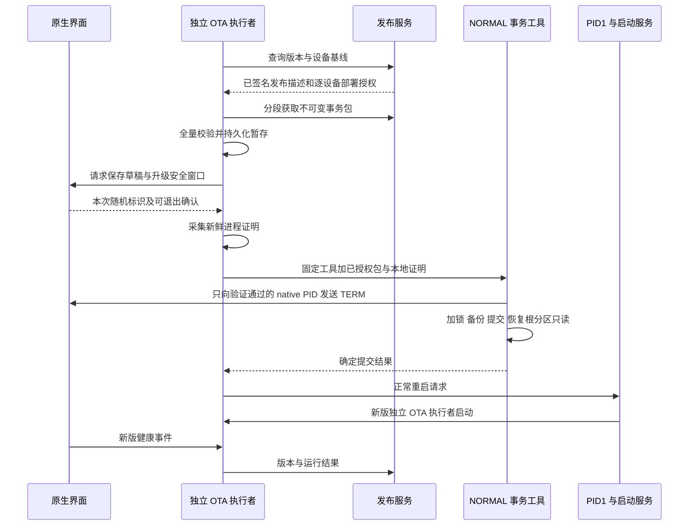

# 设备端 OTA 自动升级详细设计

本设计面向 PandaNote 966U2 设备端及负责发布升级包的维护者。目标是在已完成可信引导部署的设备上，自动检查版本、下载并验证升级包，在安全窗口安装、重启、验证运行结果并上报。采用现有 `normal-exact-upgrade-v1` 普通文件事务，保留精确设备检查、旧版本闭包、只读根分区与 USB 救援能力。

本次交付是可供实施的设计，以下标为“新增”的组件、接口与测试均尚未实现。首版升级应用及其配套 normal boot 普通文件；内核、bootloader、GPT、原厂固件、分区布局和原始块写入不在范围内。跨启动故障由受控救援恢复，不把当前实现描述成具备分区 A/B 或硬件断电保证。

## 代码依据与复杂度

设计基线为 `ff558263b2113c908106f7abc1e20fdf106a7695`。路径均相对仓库根目录。

| 现有入口 | 已有能力 | 对 OTA 的影响 |
| --- | --- | --- |
| `apps/reader-shell/deploy/normal_boot/build.py`、`upgrade_profile.py` | 候选绑定旧包摘要、完整旧闭包、旧入口及 current、新鲜根超级块摘要 | 同一逻辑版本需要按设备安装基线生成候选，不能向所有设备直接发送同一事务包 |
| `apps/reader-shell/deploy/normal_boot/normal_upgrade.py` | 离线捕获、ADB 采集证明、构建 `PANDANOTE-UPGRADE-1`、受控调用 | Python 和 ADB 是主机流程，不作为设备运行依赖；将证明采集移入本地原生组件 |
| `apps/reader-shell/deploy/normal_boot/apply_tool.c`、`upgrade_wire.h`、`upgrade_target.h` | NORMAL 身份、旧闭包、进程所有权、存储与挂载检查，普通文件持久化提交及精确回退 | 复用事务核心；增加授权入口，保留原有受控入口和 RAM 模式隔离 |
| `apps/reader-shell/deploy/normal_boot/service.in` 的 `normal_release` | 按编译模板中的 native SHA 和 release 索引选择启动版本 | `current` 是管理指针，不能靠单改它激活新版本；必须最后提交配套 `inittab` |
| `apps/reader-shell/deploy/normal_boot/service.in` 的 `normal_rescue` | 应用退出后停止所属 app 会话并保持 USB 救援 | 执行升级的进程必须独立于 app 会话；当前救援循环不会主动启动新版 |
| `apps/reader-shell/sync.h`、`sync.cpp`、`tls.cpp` | 非阻塞 HTTPS、端点和证书检查、有界内容请求 | 可复用传输基础；现有响应保存在 `QByteArray`，不能直接用来缓存最大升级包 |
| `apps/reader-shell/main.cpp`、`standbypolicy.h` | 内容同步、待机与定时维护；维护预算 30 秒 | OTA 必须有单独调度和取消规则，不延长每次待机维护窗口来下载大包 |
| `apps/reader-shell/deploy/normal_boot/suspend.in` | 休眠与安装共用 `/user/pandanote/state/normal-install.lock` | 继续以该锁排斥提交和休眠，避免两套互斥协议 |
| `apps/reader-shell/battery.h`、`battery_posix.cpp` | ADC 电压、可选估计电量、充电状态可能未知 | 不把 USB 连接当作正在充电；测量不可信时推迟自动安装 |
| `apps/manager/manager/reader.py`、`cloud.py`、`apps/shared/DEVICE_HTTP_V1.txt` | 内容 manifest、资源和显示确认 | OTA 新增独立协议，内容版本、显示 ACK 与程序升级结果分开记录 |

整体复杂度为中高。写入事务已经具备基础，主要工作是补齐发布授权、本地证明、独立执行与重启后的结果关联。按熟悉现有代码的一名工程师估算，连续实施约需 15 至 25 个工作日，包括主机故障注入与受控设备验证；外部工具链、参考输入和真机排期另计。该估算是工作量判断，不是已排定的工期。

当前部署说明明确记录命名迁移：历史 `APPLY-HANDOFF.md` 中的包摘要、时间、安装记录不能代替当前设备事实。真正启用前必须读设备现态并验证；若设备路径、数据库身份与源码契约冲突，停止写入并报告，不自动迁移或替换 pin。

## 首版方案与边界

首版继续更新已有不可变 release 和 system 目录，提交顺序保持“持久化新文件 → current → inittab → 根分区恢复只读”。不引入新的启动槽位。新旧系统通过各自入口绑定各自的 release，旧文件保留用于精确回退。

| 方案 | 结论 | 原因 |
| --- | --- | --- |
| 复用精确 NORMAL 普通文件事务 | 首版采用 | 可直接复用现有身份校验、文件白名单和恢复路径 |
| 仅改 current 后重新启动应用 | 不适用当前启动契约 | 服务绑定固定 release 和索引，且应用退出会进入救援 |
| 分区 A/B、整盘镜像升级 | 不纳入首版 | 需要新的启动选择、分区和硬件恢复验证，超出已有约束 |
| 下载脚本后由 shell 执行 | 不采用 | 不能限定写入目标、授权范围、事务顺序和恢复证据 |

首版可自动完成正常路径；可捕获安装错误时复用现有进程内恢复。安装结果不确定、系统启动失败或新程序无法健康确认时，保留证据并进入受控救援流程，不无限重启，也不自动清除旧 attempt 标记。首版暂不支持用户数据格式迁移，候选必须保持旧版可读，笔记、草稿、词卡、Wi-Fi、证书和设备凭证不在升级写入清单内。

## 组件与进程生命周期



新增 `ota-worker.mipsel`，从启动服务校验过的 release 内执行，路径为 `/user/pandanote/apps/releases/<native_sha256>/ota/ota-worker.mipsel`。它不属于 app supervisor 的进程组，不依赖 QtGui，不因关闭界面而被一起杀死。可链接现有 QtCore 与 TLS 封装，使用独立事件循环，禁止映射 `libQtGui`，以免破坏事务工具的额外 Qt 进程检查。

`service.in` 在存储和 release 校验完成后、启动 app 前启动 OTA 执行者；服务记录其 PID、starttime、可执行文件摘要并负责精确停止和回收。未有待执行事务时 worker 退出或出错只关闭 OTA，继续普通界面和 USB。执行过程中 worker 意外退出则不自动重新安装，服务标记需要核对事务。`normal_rescue` 保留 worker 和 adbd，只有 PID1 的正常关机处理才停止全部所属会话。

旧 worker 在安装完成至重启之间继续使用旧不可变 release。新版 `service.in` 启动新版 worker；持久化状态协议固定为 `ota-state-v1`，不兼容的 worker 版本必须拒绝自动发布。首版禁止 OTA 自行改变签名根、受信任 helper 协议或状态格式；此类更新走受控引导部署。

新增 worker 使用现有 root 身份运行。其模块隔离用于限制误操作，不宣称抵御已经获得设备 root 的攻击者。网络输入不能提供程序路径、shell 命令、任意 URL 或任意文件系统目标。

## 引导部署与设备基线

已有设备没有 OTA worker、发布公钥、重启请求处理或新健康协议，不能靠服务端发布包自动获得这些能力。首次启用通过现有受控 NORMAL 流程安装一个引导版本，正常重启验收后才开放自动策略。这是实施后的启用步骤，本次设计交付无需操作设备。

引导版本必须同时安装以下内容并纳入既有构建闭包：

1. worker、增加独立签名校验入口的 NORMAL helper、受信发布公钥与固定端点配置。
2. 启动服务的 worker 生命周期、受限重启请求处理、OTA 与休眠的协调逻辑。
3. 界面中的自动升级开关、版本状态、草稿保存和健康事件接口。
4. 经独立审核的本机基线记录：设备稳定身份、当前完整包 manifest、旧闭包和恢复材料位置。

设备身份使用已配发且与认证绑定的稳定 ID，不以所有设备相同的 USB serial 作为唯一标识。复用设备认证体系的前提是服务端能把凭证唯一映射到该设备；旧版共享 token 安装需要在引导时单独配发 OTA 凭证。凭证使用私有普通文件存储，不放进 URL、命令行、环境、日志或示例。

首次启用保持 `auto_install=0`；完成对应硬件和安装基线的验证后，维护者开启允许自动升级的设备范围，用户在设备端开启自动安装。服务端不能越过本地关闭策略。开启后，普通发布无需逐次人工确认。

## 签名与发布物

HTTPS 负责传输身份，独立发布签名决定什么内容可以安装。公钥随引导版本安装，私钥由隔离签名服务持有，普通 API 进程不能读取。采用 ECDSA P-256 与 SHA-256，复用仓库已固定的 Mbed TLS 3.6.7 构建输入及已有 ECDSA 配置；新增验签能力仍需独立构建验证。

签名输入为 `SHA256(domain || raw_payload)`，其中 `domain` 分别固定为 ASCII `PANDANOTE-OTA-RELEASE-1\n` 和 `PANDANOTE-OTA-DEPLOYMENT-1\n`。`raw_payload` 是传输的原始 UTF-8 JSON 字节，禁止验签前重序列化。外层固定 `{schema,key_id,payload_b64,signature_b64}`，`schema=1`，Base64 必须规范，`key_id` 只能选本地已有公钥，签名采用 DER 编码；全部输入长度先检查。ECDSA 验签接口接收摘要和签名的形式见 [Mbed TLS 官方接口说明](https://mbed-tls.readthedocs.io/projects/api/en/v3.6.4/api/file/ecdsa_8h/)，最终以仓库固定 3.6.7 头文件和向量测试核对。

新增两个发布对象：

| 对象 | 必填字段与限制 | 作用 |
| --- | --- | --- |
| 发布描述 `release.json` | `schema=1`、`model`、`channel`、`sequence`、`version`、`native_sha256`、`boot_id`、`ota_abi=1`、`workspace_schema=1`、`files[]` | 签名批准一套确定的新 release 与 system 普通文件；`sequence` 是正整数安全序号，显示版本不参与排序 |
| 部署授权 `deployment.json` | `schema=1`、`device_id`、`request_nonce`、`release_sha256`、`sequence`、`old_package_sha256`、`old_native_sha256`、`old_boot_id`、`old_inittab_sha256`、`old_current_sha256`、`live_superblock_sha256`、`candidate_sha256`、`bundle_sha256`、`bundle_bytes`、`helper_sha256`、`issued_at`、`expires_at` | 绑定该设备、该次请求、精确基线、事务包与预安装 helper；有效期最多 24 小时 |

`files[]` 每项为现有 `{path,mode,bytes,sha256,role}`。最多 128 项，目标白名单沿用事务工具：新 system、新 release、唯一 current 和唯一 inittab；system 为 0600，release 仅 0600 或 0700，current 为 0600，inittab 为 0644。拒绝重复路径、越界路径、硬链接、符号链接、设备文件、未知 role，以及任何用户数据目标。设备端对候选 manifest、签名文件清单、wire 包逐项比对，不能只验证外层包摘要。

发布描述签名原文最大 256 KiB，部署授权原文最大 16 KiB，签名最多 128 字节，事务 wire 总长最多 24 MiB；HTTP 外层上限分别为 352 KiB 和 24 KiB。JSON 拒绝重复键、未知字段、非整数序号、溢出、非法 UTF-8 和嵌套超过 8 层。不得直接复用 `sync.cpp` 中最多 8 个数组成员的内容 JSON 解析器解析发布文件清单；新增独立有界解析器。所有摘要固定 64 位小写十六进制，boot ID 固定 24 位小写十六进制。

### 逐设备候选的生成

发布流水线先准备完整受审 native、system、旧包基线及原始构建输入，批准发布描述。设备查询携带旧包摘要及新鲜超级块摘要后，签名服务只允许从已批准发布生成候选，复用 `build.py` 与 `upgrade_profile.bind` 的精确旧包约束，再用 `normal_upgrade.capture_bundle` 生成 wire。

不得把设备提供的清单、文件内容或任意路径当作签名输入。服务通过 `old_package_sha256` 在受控基线库中找完整旧包，重新校验闭包，再绑定设备上传的超级块摘要。不同超级块或旧闭包产生不同候选及 bundle SHA。签名服务校验新文件恰好匹配批准的发布描述，入口和 current 指向批准版本，才签发部署授权。构建输入缺失返回稳定错误，不从在线设备反向收集并信任旧系统文件。

这里保留逐设备生成的成本，以避免取消现有超级块精确 pin。安装前重新读取超级块，若与授权不符且尚未调用写入 helper，废弃该授权并重新查询；已开始事务则先恢复核对，不能为绕过失败而重新签发新候选。在线签名服务不可用时不安装，已有内容同步继续。

### 版本与防重放

worker 持久化最高已接受的发布序号以及对应描述摘要。同序号同摘要允许恢复下载；同序号不同摘要拒绝；低于高水位拒绝。高水位在完整验签和设备匹配后持久化，不能因回退旧程序而降低。同一失败 release 保留失败记录，不自动重试安装；发布者使用更高序号纠正。

本次请求使用系统随机源生成 32 字节 nonce，部署授权必须精确回显，网络超时重试使用相同 nonce，跨查询轮次使用新 nonce。到期校验使用可信 TLS 时间基础加同次启动的单调时钟；时间不可信或跨启动无法确认有效期时重新获取授权，不关闭证书时间检查。回退只允许针对已记录事务恢复被备份的旧版本，不开放任意降级接口。

首版固定签名根。密钥失陷时停止发布并受控重新配发引导版本；不设计从未受信网络自动取新根的捷径。

## 服务端协议

新增协议文档 `apps/shared/DEVICE_OTA_V1.txt`，与现有内容 HTTP v1 并列。以下接口均为拟新增，不在当前服务中存在。仅挂载到设备认证后的 reader surface 或按设备隔离的 cloud 前缀，不能暴露管理端。逻辑路径由既有端点前缀函数转换，部署授权不能改变主机、端口或信任配置。

所有请求沿用 HTTPS 和 Bearer 私有凭证，拒绝 Origin、Cookie 身份、查询字符串、跨域和重定向；服务端从认证上下文选择设备，不信任请求体的设备 ID。POST 必须提供 Content-Length，禁用 Transfer-Encoding，正文有界。所有失败返回 `{schema:1,ok:false,error:{code,message}}`，message 为固定非敏感代码。

| 接口 | 请求及响应 | 行为 |
| --- | --- | --- |
| `POST /reader/v1/ota/check` | 正文最多 4096 字节，固定字段 `schema,request_nonce,model,channel,ota_abi,old_package_sha256,old_native_sha256,old_boot_id,old_inittab_sha256,old_current_sha256,live_superblock_sha256,highest_sequence`；200 返回两个签名封装及候选 manifest，合计最多 768 KiB | 无更新返回 200 和固定 `{schema:1,status:"no_update"}`；候选尚在生成返回 202 和 `retry_seconds`，范围 30 至 300 秒；旧基线不支持返回 409 |
| `POST /reader/v1/ota/chunk` | 正文最多 1024 字节，固定 `schema,bundle_sha256,index`；200 返回原始字节，必须带准确 Content-Length | 服务鉴权后仅允许取本设备已授权 bundle；固定分段 256 KiB，最后一段按实际长度，索引从 0 开始且不越界 |
| `POST /reader/v1/ota/report` | 正文最多 4096 字节，固定 `schema,attempt_id,event_id,sequence,bundle_sha256,active_native_sha256,state,error_code,boot_id` | 幂等键为认证设备与 `event_id`；200 `{schema:1,ok:true}`，超时可重传；报告不携带笔记或 token |

检查接口有更新时 200 的外层固定为 `{schema:1,status:"update",release,deployment,candidate_b64}`，其中 `release` 和 `deployment` 是上述签名封装，202 固定为 `{schema:1,retry_seconds}`。所有成功响应显式提供 Content-Length；无更新也返回有界 JSON，以满足现有 `HttpReply` 的严格长度要求。安装报告的 state 仅接受状态表中的值，error_code 为预定义枚举，`event_id` 为本机生成的 32 位小写十六进制随机值。

部署响应中的 candidate manifest 为原始 UTF-8 字节的规范 Base64，解码后最多 256 KiB，其摘要必须等于部署授权中的 `candidate_sha256`。服务禁止从请求内容直接拼接文件路径；bundle 以服务端私有索引定位，按固定摘要不可变存储。下载响应保留所打开文件描述符并读取指定区段，拒绝文件替换、大小变化及非普通文件，不在响应时重新打开路径。

首版使用固定分段 POST，避免修改现有客户端实现 Range/206 和可变重定向语义。每次下载调用仍使用独立 `DeviceHttp`，限制响应最多 256 KiB，校验长度后追加至本机部分文件；不用完整包 `QByteArray`。下载段本身不另设信任，安装前必须对完整 bundle 计算签名授权绑定的 SHA-256。发现最终摘要错误删除该部分下载并标记发布错误，不执行安装。

服务存储新增三个逻辑集合：不可变发布、绑定设备的部署授权、升级事件；迁移实现时在 `store.py` 中新增独立表并做旧数据库迁移测试。内容 `last_displayed_version` 不写入程序版本。状态展示区分“已发现、已下载、已提交待重启、已运行确认、需恢复”，不能把 API 成功或安装工具退出码显示为“升级成功”。

## 本地目录与持久化

| 路径 | 内容与权限 |
| --- | --- |
| `/user/pandanote/ota/` | root 私有目录 0700，OTA 专属，不复用内容 cache |
| `/user/pandanote/ota/downloads/<bundle_sha256>/` | 签名封装、candidate manifest、`bundle.part`、完成后的 `bundle.wire`、下载检查点；文件 0600 |
| `/user/pandanote/ota/attempts/<attempt_id>/` | 状态、授权摘要、本地 proof、结果及待上报事件；文件 0600，只追加或原子替换 |
| `/user/pandanote/ota/policy.json` | 本地开关、channel、自动安装窗口；0700 父目录、0600 文件 |
| `/user/pandanote/ota/security.json` | 最高接受序号、描述摘要和失败发布记录；禁止回退时覆盖 |
| `/user/pandanote/ota/worker.lock` | worker 独占运行锁，防止重复编排 |
| `/user/pandanote/state/normal-install.lock` | 现有事务与休眠互斥锁，最终提交继续由 helper 获取 |
| `/home/pandanote-system/transactions/<bundle_sha256>/` | 现有 helper 的精确备份与事务证据，worker 不删除、不改名 |
| `/run/pandanote-normal/ota/` | 当前启动随机标识、界面应答、进程身份及重启请求，0700，文件 0600；重启即失效 |

所有路径逐级使用目录描述符和 `O_NOFOLLOW` 验证；普通文件需 root 所有、单链接，目录不得允许其他用户写入。写入状态统一采用同目录临时文件、写完、检查关闭及 fsync、rename、父目录 fsync。所有错误都必须处理；不把 `QFile::flush` 等同于持久化。

下载检查点保存 `{schema,bundle_sha256,expected_bytes,durable_bytes,next_index}`。每完成一段先 fsync 部分文件，再持久化检查点。恢复时验证目录、文件大小与摘要上下文，从 0 重新计算已持久化前缀的 hash；文件短于检查点则重新下载，长于检查点的尾部截去并 fsync，再从已完成段继续。完整文件 hash、字节数和签名均通过后 rename 为 `bundle.wire` 并 fsync 目录，才能进入 `VERIFIED`。

不跨 `/user` 与 `/home` 使用 rename 假装原子提交。跨盘状态通过阶段和实际入口核对恢复，事务工具的备份是恢复依据。ext4 的延迟分配和 rename 不能代替明确同步；相关语义参见 [Linux ext4 官方说明](https://www.kernel.org/doc/html/v6.5/admin-guide/ext4.html)。目标设备根分区可能保留 `norecovery`，现代内核文档不构成目标设备断电持久性的证明。

## 状态机与恢复

状态记录固定包含 `schema=1,attempt_id,phase,phase_seq,sequence,release_sha256,candidate_sha256,bundle_sha256,old_package_sha256,old_native_sha256,new_native_sha256,old_boot_id,new_boot_id,error_code`。其中 attempt ID 为本机 32 位小写十六进制随机值，创建目录使用排他语义。进入阶段前后都先检查持久化结果；状态文件不能作为唯一成功证据。

| 阶段 | 进入条件与动作 | 中断后处理 |
| --- | --- | --- |
| `IDLE` / `CHECKING` | 策略开启且到轮询时间，读取精确基线和只读超级块，生成 nonce 查询 | 原应用继续运行；下次按退避重试 |
| `OFFERED` | 验签、设备匹配、版本和有效期检查通过，更新安全高水位 | 重启后重新确认授权有效期 |
| `DOWNLOADING` | 下载固定段并持久化检查点 | 从持久化段继续；不执行部分包 |
| `VERIFIED` | 全包、候选、批准清单、预安装 helper 完全匹配 | 可等待电源与用户空闲 |
| `WAITING_SAFE_WINDOW` | 用户策略、电源、草稿、网络与低功耗条件满足 | 条件变化则继续等待，不退出应用 |
| `APPLYING` | 持久化本次 attempt，生成新鲜 proof，调用已授权 helper | 重启后进入 `RECOVERY_REQUIRED`，禁止再次自动 forward |
| `COMMITTED_PENDING_REBOOT` | helper 确认提交、根只读、实际入口和文件校验通过并已持久化 | 当前入口恰为新版且闭包正确时可请求一次正常重启；若已运行新版则转健康检查 |
| `BOOT_VERIFYING` | 当前 native、system 与授权新版匹配，记录本次启动 ID | 同一 attempt 不重复安装，等待新版健康条件 |
| `HEALTHY` | 运行健康全部通过，持久化成功事件 | 离线只延迟报告，不触发回退 |
| `ROLLED_BACK` | helper 证明精确旧入口恢复且根只读 | 保持旧版并记录失败版本；由受控流程恢复应用或重启 |
| `RECOVERY_REQUIRED` | 工具结果丢失、异常入口、备份异常或健康失败 | 保留 USB 和全部证据，停止自动安装及自动重启 |

恢复优先级为实际设备身份与只读状态、精确 old/new 入口和闭包、helper 备份和结果，最后才参考 worker 状态。若 worker 在 helper 成功后、落盘 `COMMITTED_PENDING_REBOOT` 前崩溃，保守进入 `RECOVERY_REQUIRED`；首版不凭猜测补写成功。若工作记录被破坏或出现既非 old 也非 new 的入口，也进入恢复状态。

状态中的上报事件与服务端显示不反向授权安装。服务端撤回发布在 `APPLYING` 前生效；进入文件事务后不因网络消息中断写入和恢复。

## 安全窗口与低功耗

自动检查优先附着已建立的联网活动，默认每 6 小时加设备随机 0 至 30 分钟偏移；首次联网稳定 60 秒后检查。下载失败退避 5 分钟、30 分钟、2 小时、6 小时并加最多 20% 抖动，成功后复位；设备离线不专门频繁唤醒 Wi-Fi。

30 秒待机维护只允许小型查询，不开始大包下载或安装。下载要求用户处于普通唤醒状态，或已开启专门维护时段且仍在既有安全电源条件内；用户要求待机时完成当前有界段后取消网络并保存检查点，不取消用户待机。安装窗口默认本地时间 02:00 至 05:00，设备已经因既有策略唤醒才尝试，不修改 RTC 或新增唤醒源；用户可在界面主动选择“立即升级”。本地时区由引导配置显式提供，不使用构建主机时区；时区未配置或时间不可信时不进入自动窗口。

进入安装必须同时满足：

- `auto_install=1`，设备属于允许范围，授权有效，发布没有本地失败记录。
- 电池读数有效，采用显式启用的工厂估计曲线时估计值至少 60%，且 `chargingKnown && charging`；充电状态未知则只允许检查或下载，不自动安装。60% 是首版保守策略，需按目标电池验证，不能当作校准结果。
- 连续空闲至少 120 秒，无笔记编辑、草稿未落盘、内容下载或等待绘制 ACK、无线配置写入、关机请求和未决休眠请求。
- 根分区当前只读，所有设备与文件系统检查通过，各文件系统空间满足预算。
- 界面已持久化草稿并回显本次随机标识，worker 采集到新鲜证明；过期应答不能复用。

新增启动服务运行策略文件与 worker 心跳协调 OTA 准备；最终仍以 helper 和 suspend helper 对同一个 `normal-install.lock` 的非阻塞锁为准。worker 不提前持有该锁再启动 helper，避免子进程重复获取导致自锁。helper 必须在最终获得锁后重新校验挂载、电源、未决关机及休眠状态，再停止 app。

界面显示 30 秒升级倒计时，允许用户推迟；倒计时中任意输入取消本次安全窗口。真正开始提交后禁止 UI 触发新关机或休眠；物理长按断电不能由软件保证，恢复章节按突然断电处理。

## 本地证明与安装步骤

新增原生 `ota-proof` 能力由 worker 调用，逐字段实现现有 `normal_upgrade.capture_proof` 和 `proof_bytes` 契约：捕获 service、adbd supervisor、app supervisor、native 的 PID、PPID、PGID、SID、starttime、真实可执行文件摘要和 argv 摘要，生成现有 `PANDANOTE-NORMAL-PROOF-1`。证明摘要和内容只在设备本地生成，不采用服务端传入的进程号。

证明在调用 helper 前立即生成，服务进程所有权、实际 inode、argv、starttime 与 pidfile 均需复核。helper 仍独立校验，不因 worker 已验过而省略任何检查。安装时只向已核对的 native PID 发送 TERM，等待准确的 `app-exited` 状态、两个 app 进程消失和 pidfile 移除；其他 Qt 进程存在、PID 复用或 USB 所有者改变时拒绝继续。

新增独立 `PANDANOTE_OTA_UPGRADE` 编译模式，构建入口拟为 `build_apply.py --ota-upgrade`，产物为 `pandanote-ota-upgrade.mipsel`；原有 NORMAL 与 RAM 产物和参数保持独立。OTA 入口必须独立验签部署授权和发布描述、复核本机身份、全包摘要、候选清单与预安装 helper SHA，然后进入同一事务核心；不能做成任何本地请求都能调用的裸写入服务。签名验证代码使用仓库固定密码库，原有 RAM 入口不增加 OTA 网络能力或放松身份约束。

新增设备调用契约为 `pandanote-ota-upgrade.mipsel --apply ATTEMPT_DIR`。只接受位于固定 attempts 根目录下的单层 32hex 目录，helper 经描述符读取固定名称的 `release.envelope`、`deployment.envelope`、`candidate.json`、`proof` 及 `bundle.ref`；引用仅为本地 64hex bundle ID，不能包含路径。helper 自行计算 proof SHA 和包 SHA，再进入既有事务核心。CLI 不接收端点、token、任意输出路径或用于关闭校验的开关。自动入口只提供 forward，精确回退继续使用独立受控 NORMAL 工具。

界面交互采用 `/run/pandanote-normal/ota/` 下固定私有文件，不新增网络控制端口：worker 写 `prepare.request`，界面写 `prepare.reply`；内容最多 4096 字节，固定包括 `schema=1,attempt_id,generation,native_pid,native_starttime`，reply 额外包含 `result`，枚举为 `ready`、`busy`、`save_failed`、`cancelled`。`generation` 是 worker 每次准备生成的 32hex 随机值，有效期为同次启动单调时间 30 秒，成功应答后立即采集 proof，超时重新准备。新增心跳每 2 秒原子替换一次，启动服务发现 10 秒未更新即撤销尚未提交的准备，不终止正在写入的 helper。健康事件使用 `health.ready`，除本次启动 generation 外还绑定当前 native PID/starttime、SHA 和绘制计数；worker 必须结合 `/proc` 复核。以上文件全部有界并使用前述私有路径和原子持久化规则。

确定安装顺序如下：

1. worker 验证签名、全包、候选、文件清单及固定 helper 的实际文件摘要；创建唯一 attempt 并持久化 `APPLYING`。helper 从已有校验通过的本地 release 执行，不执行下载包中的新 helper。
2. helper 校验输入、证明、NORMAL 身份、旧闭包、旧入口和 current、挂载拓扑；获取现有安装锁后再次检查所有随时间变化的前提。保留服务和 USB，准确交接 app。
3. 在 `/home` 现有事务目录持久化旧入口、current 与备份元数据。attempt 标记已存在即拒绝 forward；worker 不删除标记重试。
4. 按部署授权要求核对新鲜干净根超级块；仅尝试一次 RW remount。失败则保持拒绝，不清除脏标志、不修改 mount 选项、不运行 fsck 或格式化。
5. 写入不可变新文件，逐文件同步，再提交 current，最后提交 inittab。保留所有旧文件，恢复根分区只读，报告明确结果。
6. worker 要求退出码成功、最终结果为 committed 且 `root_rw=0`，并只读复核实际入口、current 及新版闭包。任何丢失结果或错误状态均不当作成功；`cleanup_ok` 在成功路径不是成功判定依据。
7. 持久化 `COMMITTED_PENDING_REBOOT` 和待上报事件；向仍存活的启动服务发送带 attempt、bundle SHA 和服务本次启动随机标识的重启请求。重启不放进文件写入工具。

`apply_tool.c` 现有 120 秒 alarm 不能中断内核不可中断 I/O。worker 不因超时发送 SIGKILL 或并发运行回退工具；保留状态，服务停止新操作，待实际工具结果或进入恢复流程。

## 重启与运行确认

新增 `service.in` 重启处理同时覆盖普通主循环和 `normal_rescue` 循环。只接受 worker 的私有请求，复核其 PID/starttime/可执行摘要以及 attempt 已确定提交；检查根只读且工具已退出、锁已释放。服务先记录已消费请求并 fsync，再调用正常 BusyBox reboot 请求 PID1，不使用强制重启，也不直接写 sysrq。重启命令失败则保持救援并标记原因。

每个 attempt 最多自动请求一次重启，持久化已请求标志后不循环重发。若重启前崩溃导致请求结果不明，进入恢复核对；不增加无限重启机制。升级后新 worker 按授权的 old/new 身份关联原 attempt，不依赖已失效的 `/run` 请求。

进入 `BOOT_VERIFYING` 后用同次启动单调时间给 180 秒预算，要求以下本地健康条件全部成立：

1. 当前 PID1、system、入口、native SHA 和 release 索引匹配授权，根分区只读，持久分区和 USB 服务有效。
2. 当前原生程序能读取既有笔记、草稿和配置，事件循环存活；至少产生一次本次启动关联的成功绘制事件。
3. worker 验证健康事件来自当前 native 的 PID/starttime，事件包含本次启动随机标识及 native SHA；旧 marker 或下载前事件无效。
4. 至少连续稳定运行 60 秒，无 app 退出或 storage/runtime rescue。

网络连接、服务器 ACK 和物理屏幕观感不作为本地健康的必需条件。程序绘制回调只表明软件路径完成，物理显示仍在真机验收中检查。180 秒到期则 `RECOVERY_REQUIRED`，不自动反复重启；成功后持久化 `HEALTHY` 并更新本地已安装基线，报告待网络可用时发送。

完整新候选 manifest 在安装前已落盘并经签名绑定，健康通过后成为下一次 `old_package_sha256` 基线；服务端同时保留该候选完整 files/闭包。不能仅保存 native SHA，因为下次 `upgrade_profile.capture_old` 需要完整包。健康失败不更新已确认基线，查询暂时禁用。

## 容量与资源预算

下载落 `/user`，不使用只有 20 MiB 的 `/tmp`，也不在 4 MiB 的 `/run` 解包。首版不压缩，不调用通用 tar 解压；wire 仍使用既有最多 24 MiB、128 个文件的有界格式。超出上限则在发布前失败，不自动放宽 helper 常量。

设 wire 大小为 `B`，所有新 release 文件字节和为 `U`，新 system 与入口字节和为 `R`，新增文件数分别为 `Nu`、`Nr`。下载前及提交前均用 `fstatvfs` 检查：

- `/user` 初始空闲至少 `B + U + 4096*Nu + max(8 MiB, ceil(0.2*(B+U)))`；已下载的 B 只能在安装前重检时扣除一次。
- 根分区空闲至少 `R + 4096*Nr + 1 MiB`，并同时满足现有 helper 的原始空间算法。
- `/home` 空闲至少旧入口与旧 current、事务元数据和现有 helper 所需预算，再加 2 MiB 状态余量。

worker 单次包下载响应最多 256 KiB，检查接口的元数据响应最多 768 KiB；摘要按 16 KiB 缓冲流式计算，不同时保留完整包副本；现有 helper 对 wire 使用 mmap，部署前记录实际峰值 RSS、可用内存与最慢 fsync 时延。内存不足只暂停或拒绝，不自动开启 swap、杀其他进程或降低校验。

首版不自动清理事务备份、未决 attempt 或旧 release。只可清理确定未进入 APPLYING 的过期下载，按目录描述符白名单删除。空间不足暂停新升级，由受控维护核对后清理，不能把回退材料当下载缓存删除。

## 故障与恢复操作

| 故障位置 | 自动行为 | 恢复依据 |
| --- | --- | --- |
| 查询、下载、签名失败 | 保持旧应用，退避或停止该发布 | 原始签名封装、稳定错误码、下载检查点 |
| 空间、电源、待机或 proof 不满足 | 安装前推迟；若 helper 已交接 app 则保持救援并记录状态 | 新鲜设备检查与 helper 输出，不能假定应用仍在运行 |
| remount 或可捕获文件写入失败 | helper 尝试精确旧 current、旧入口恢复并恢复根只读 | `rolled-back-root-ro`、退出结果和实际文件核对 |
| 工具被杀、突然断电、结果缺失 | 不再 forward，不自动重试 | 原 bundle、备份目录、实际入口及只读/脏状态 |
| 新 system 或应用启动失败 | 保持可用的 USB 救援，记录需要恢复；系统未到 USB 阶段则用已验证外部救援路径 | 引导前保留的完整旧包、同一事务包与 helper |
| 本地健康通过但上报失败 | 保持 HEALTHY，幂等重传结果 | 本地成功事件与当前实际 native |

维护者恢复时先只读核对设备身份、实际挂载、旧/新入口、进程所有者与备份摘要。可在有效 NORMAL 上下文中使用现有 `normal_upgrade.py` 的受控回退入口；必须保留同一 captured candidate、bundle、工具摘要及对应源码快照；现有主机 transport 还会校验源码新鲜度，不能在已经改变的源码树中假定旧工具可直接运行。若已重启到新版，按现有流程采集 `--active new` 的新 proof，不能重用旧进程号。

现有命令形态如下，占位值必须由受控环境提供：

```sh
python3 apps/reader-shell/deploy/normal_boot/normal_upgrade.py \
  --package RETAINED_CANDIDATE \
  --candidate-sha256 REVIEWED_CANDIDATE_SHA \
  --tool-dir RETAINED_TOOL \
  --tool-manifest-sha256 REVIEWED_TOOL_MANIFEST_SHA \
  --serial PANDANOTE966U2_NORMAL --adb-port 5037 \
  --proof FRESH_PROOF --proof-sha256 REVIEWED_PROOF_SHA \
  --rollback --execute-once --attempt-id FRESH_ATTEMPT \
  --journal FRESH_HOST_JOURNAL
```

该命令是恢复操作格式，不是本次执行记录。NORMAL 条件不满足时不能把 serial 或 proof 改成能通过的值；回到已验证的外部救援流程，保持证据，按对应受控工具恢复。首次引导部署前必须验证本设备可用的救援路径，不能从历史描述推断当前机器仍具备该能力。

## 连续实施顺序与文件映射

以下是同一目标内的实施顺序，不创建独立 issue 或子任务。先固定数据契约，再实现最小闭环，最后开放自动策略。

| 顺序 | 涉及文件 | 可执行产出与通过条件 |
| --- | --- | --- |
| 1 | 新增 `apps/shared/DEVICE_OTA_V1.txt`、`apps/reader-shell/ota.h`、`ota.cpp` | 固定签名原文、字段、上限、错误码、状态迁移；用合成发布物验证正反向解析 |
| 2 | 新增 `apps/reader-shell/ota_worker.cpp`、`ota_storage.cpp`、`ota_proof.cpp`；修改 `build.py`、`build_tls.py` 的必要构建闭包 | 生成无 QtGui 的目标 worker，持久化及采集证明；主机测试替换系统调用，不执行目标 ELF |
| 3 | 修改 `deploy/normal_boot/apply_tool.c`、`upgrade_wire.h`、`upgrade_target.h`、`build_apply.py`；新增共享 `ota_authorization` 实现 | 新增签名 OTA 入口，复用原事务，final lock 后复查动态前提；原 NORMAL/RAM 模式回归通过 |
| 4 | 修改 `deploy/normal_boot/service.in`、`suspend.in`、`build.py`，及 `main.cpp`、`shell.h`、`shell.cpp` | 独立 worker、草稿与安全窗口、重启处理、健康事件均纳入新闭包；不破坏 USB 与现有安装锁 |
| 5 | 新增 `apps/manager/manager/ota.py`、发布工具；修改 `reader.py`、`cloud.py`、`store.py` | 认证隔离的三条设备接口、受审发布签名流程、逐设备候选生成与完整旧包留存；数据库迁移可在副本上验证 |
| 6 | 新增主机 OTA 测试及协议夹具，扩展 normal boot 事务测试 | 在普通文件 clone 中完成查询、下载、提交、恢复、模拟重启和健康上报；每个持久化边界注入故障 |
| 7 | 更新设备 `DEPLOYMENT.md` 与 `DEVELOPMENT.md` 的实际实现说明 | 构建受控引导包，先一台设备验收，再按稳定 ID 灰度开放，失败立即停止新增部署 |

只新增有明确职责的源码文件；具体拆分可按现有构建组织收敛，但不能把安全校验留给 UI，不能在设备端引入 Python、curl 命令或 ADB 服务依赖。所有新增文件、helper、模板和密码配置都必须进入 native/system 构建来源摘要及工具 manifest；文件数、权限和闭包校验随构建更新，不能只拷贝未索引的二进制。

## 验证与完成条件

设计阶段只定向核实已有事务边界；实现阶段按下表验证，最终系统门禁由系统执行。以下是未来实现验收，不代表当前代码已经通过这些 OTA 用例。

| 验证范围 | 必测场景 | 通过标准 |
| --- | --- | --- |
| 发布授权 | 篡改包、错误公钥、错误设备、错误 nonce、过期、版本回放、同序号不同摘要、重复字段、过长 JSON | 在调用事务写入前拒绝，旧版本与数据不变 |
| 文件与下载 | 断网、缺段、超长段、错误长度、服务替换文件、错误最终 SHA、符号链接和硬链接、检查点前后断电 | 部分包不执行，可从持久化段恢复，无越界文件写入 |
| 进程交接 | PID 重用、所有权改变、额外 Qt、草稿保存失败、USB supervisor 退出、worker 位于错误进程组 | 不误杀、不写入；准确 app 退出后 worker 和 USB 存活 |
| 低功耗与电源 | 未知电池、未知充电、低电量、已有休眠 token、锁竞争、关机请求、用户取消 | 推迟或拒绝；没有休眠与安装并发或重复持锁死锁 |
| 原生事务 | 每个文件/目录 fsync 失败，current 前后及 inittab 前后终止，remount 失败与脏超级块 | 确定回退或明确需要恢复；不删除 attempt，不改变 RAM 模式 pin |
| 重启确认 | 新 native 匹配与不匹配、旧健康 marker、首次绘制失败、断网、worker 崩溃、reboot 返回错误 | 仅本次启动且稳定运行才 HEALTHY；无循环重启、无假成功 |
| 服务端 | 鉴权错误、跨设备取包、旧基线缺失、签名服务离线、事件重传、旧数据库迁移 | 设备隔离和幂等成立，内容同步与显示状态不混淆 |
| 真机 | 一次正常自动升级、安装前取消、受控断网、可恢复写入故障、实际 USB 救援与精确回退 | 核对画面、按键、Wi-Fi、蓝牙、待机唤醒、笔记和草稿；原厂保护与根只读保持 |

主机测试优先复用 `deploy/normal_boot/tests/test_upgrade_boundaries.py` 的 syscall 替换方式、`test_upgrade.py` 的普通文件 clone，以及现有 sync/TLS 和 suspend 夹具。`test_upgrade.py` 依赖未随公开源码分发的完整旧包，不能用空 fixture 冒充生产闭包验证。

启用自动策略必须同时满足：签名链及逐设备候选生成可用、完整旧包可追溯、故障注入通过、目标 helper 编译审查通过、引导安装验收通过、至少一台设备完成“自动安装到健康上报”以及同一事务的精确恢复验证。突然断电试验仅在具备外部恢复的受控设备进行，主机 fixture 不替代物理闪存验收。

## 取舍与扩展边界

方案的优势是复用已有的 NORMAL 安全检查、事务顺序和恢复证据，不改分区，正常升级无需连接主机。代价是逐设备候选与签名服务增加发布成本，需一次受控引导安装，且首版启动失败仍需救援恢复。电源状态不可确认的设备可能长期只下载而不自动安装，这是明确的默认策略。

分区 A/B、独立常驻恢复引导器、自动跨启动回滚、差分或压缩包、远程根密钥轮换和用户数据迁移属于后续扩展，均不作为首版正常 OTA 的隐含承诺。若将来要求无人值守地恢复任何启动故障，需要单独评估引导与存储架构，不能通过放宽现有 exact profile 实现。
